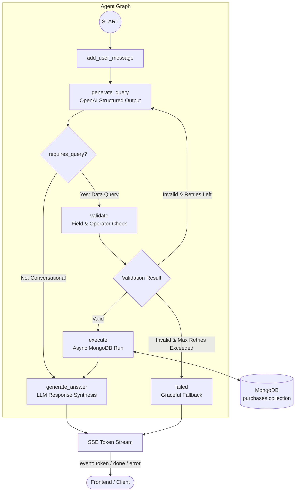

# Procurement AI Assistant — Backend API

AI intelligent, procurement data assistant backend built with **Python**, **FastAPI**, **LangGraph**, **MongoDB**, and **OpenAI**.

This application translates natural-language procurement questions into secure MongoDB queries (`find` filters and aggregation pipelines), validates them against strict operator and field allowlists, autonomously self-corrects invalid queries, executes them asynchronously, and streams grounded, human-readable answers in real time via Server-Sent Events (SSE).

---

## Table of Contents

- [Features](#features)
- [Architecture & Workflow](#architecture--workflow)
- [Tech Stack](#tech-stack)
- [Project Structure](#project-structure)
- [Query Safety & Guardrails](#query-safety--guardrails)
- [Dataset Context](#dataset-context)
- [Data Preparation](#data-preparation)
- [API Reference](#api-reference)
- [Configuration & Environment Variables](#configuration--environment-variables)
- [Evaluations](#evaluations)
- [Design Decisions & Trade-offs](#design-decisions--trade-offs)
- [Getting Started](#getting-started)
- [Limitations & Roadmap](#limitations--roadmap)
- [Author](#author)

---

## Features

- **Natural Language to MongoDB (MQL):** Translates complex procurement inquiries into structured MongoDB `find` filters and multi-stage `aggregate` pipelines using OpenAI structured outputs (`function_calling`).
- **Autonomous Query Self-Correction:** When validation detects an invalid field, unsupported operator, or malformed pipeline, the error feedback is automatically fed back to the LLM to regenerate a corrected query (configurable retry limit).
- **Two-Tier Safety & Allowlist Validation:** Strict AST-style recursive validation enforces allowed query stages (`$match`, `$group`, `$sort`, `$limit`, `$project`), authorized operators, and a schema-defined field allowlist—preventing arbitrary operations, code injection, and unsafe operator usage.
- **Smart Intent Routing:** Distinguishes between database-bound queries and conversational questions/greetings, routing direct chit-chat straight to answer generation without hitting the database.
- **Automated Type Coercion:** Automatically converts ISO date strings into native BSON/Python `datetime` objects for date-based filters (`creation_date`, `purchase_date`), and serializes BSON `ObjectId`s.
- **Real-Time Token Streaming (SSE):** Incrementally streams generated responses using Server-Sent Events, emitting token chunks, execution metadata (including the generated query and pipeline), and structured error events.
- **Stateful Conversational Memory:** Uses LangGraph's checkpointer (`InMemorySaver`) keyed by `thread_id` to maintain multi-turn conversational context with sliding window history management.
- **High-Performance Async Pipeline:** Fully asynchronous runtime leveraging FastAPI lifespans, `AsyncMongoClient` (PyMongo Async), and LangGraph asynchronous execution (`astream`).

---

## Architecture & Workflow

The agent orchestrates state transitions through a directed cyclic graph implemented with **LangGraph**:



### Agent State Lifecycle

1. **`add_user_message`:** Appends the user question to the message history and resets transient execution state (`query`, `pipeline`, `results`, `error_message`, `retry_count`).
2. **`generate_query`:** Invokes OpenAI using Pydantic structured output (`QueryGeneration`) with system prompts and recent conversation history (limited by `MAX_HISTORY_MESSAGES`). If a prior error occurred, the error context is injected for self-correction.
3. **`route_after_query`:** Inspects `requires_query`. If `False`, skips database execution and routes directly to `generate_answer`.
4. **`validate`:** Recursively checks all query keys, operators, stages, and field names. On failure, increments `retry_count` and stores `error_message`.
5. **`route_after_validation`:**
   - **Success:** Routes to `execute`.
   - **Failure (`retry_count <= MAX_RETRIES`):** Cycles back to `generate_query` with feedback.
   - **Exceeded Retries:** Routes to `failed`, generating a clear, polite error response.
6. **`execute`:** Converts date strings to native datetimes, executes `find` (capped at 20 docs) or `aggregate` (with `maxTimeMS=10000`, capped at 100 docs) asynchronously against MongoDB, and serializes `ObjectId` values.
7. **`generate_answer`:** Feeds retrieved records, filter details, and conversation context into the LLM to formulate an accurate, data-grounded natural-language reply.

---

## Tech Stack

| Technology | Role |
|---|---|
| **Python 3.14+** | Core runtime environment |
| **FastAPI** | High-performance asynchronous web framework |
| **LangGraph** | Cyclic state-graph agent orchestration and conversation checkpointing |
| **LangChain OpenAI** | LLM integration and structured output parsing (`function_calling`) |
| **MongoDB & PyMongo Async** | Document database with native asynchronous client (`AsyncMongoClient`) |
| **Pydantic & Pydantic Settings** | Data validation, query schema enforcement, and environment configuration |
| **Colorlog** | Formatted, color-coded logging for debugging and audit trails |
| **uv** | Fast Python package and dependency manager |

---

## Project Structure

```text
procurement-ai-api/
├── src/
│   └── procurement_ai_api/
│       ├── agent/
│       │   ├── graph.py            # LangGraph StateGraph definition and compilation
│       │   ├── helpers.py          # Date filter conversion and BSON serialization
│       │   ├── nodes.py            # Graph node implementations (query gen, exec, answer)
│       │   ├── prompts.py          # Domain-specific system prompts and schema definitions
│       │   ├── routing.py          # Conditional edge routing functions
│       │   ├── schemas.py          # Agent Pydantic output schemas (QueryGeneration)
│       │   ├── state.py            # AgentState TypedDict definition
│       │   └── validation.py       # Security allowlists (stages, operators, fields)
│       ├── api/
│       │   └── routes/
│       │       └── chat.py         # /chat/ API route with StreamingResponse
│       ├── core/
│       │   ├── config.py           # Pydantic Settings configuration from .env
│       │   ├── database.py         # AsyncMongoClient lifecycle and connection manager
│       │   └── logging_config.py   # Colored stream logging setup
│       ├── schemas/
│       │   └── chat.py             # ChatRequest and ChatResponse schemas
│       ├── services/
│       │   └── chat_service.py     # SSE generator streaming tokens and done/error payloads
│       └── main.py                 # FastAPI application, CORS middleware, lifespan setup
├── .env.example                    # Sample environment variables template
├── .gitignore                      # Git ignored files and directories
├── .python-version                 # Python version specification
├── pyproject.toml                  # Project metadata, dependencies, and scripts
├── uv.lock                         # Locked dependency graph
└── README.md                       # Project documentation
```

---

## Query Safety & Guardrails

The agent prevents database exploitation, query injection, and denial-of-service through several security layers:

1. **No Raw Code Execution:** The LLM produces strict JSON/Pydantic structured output, never executable Python code or arbitrary string-concatenated commands.
2. **Field Allowlist (`ALLOWED_FIELDS`):** Only pre-approved procurement fields (`creation_date`, `purchase_date`, `department_name`, `total_price`, `supplier_name`, etc.) can be queried or matched.
3. **Stage Allowlist (`ALLOWED_STAGES`):** Only safe, read-only aggregation stages are allowed:
   - `$match`, `$group`, `$sort`, `$limit`, `$project`.
   - Dangerous stages like `$out`, `$merge`, `$lookup`, and `$accumulator` are rejected immediately.
4. **Operator Allowlist (`ALLOWED_OPERATORS`):** Restricts query operators to safe comparators (`$eq`, `$gt`, `$gte`, `$lt`, `$lte`, `$in`), logical operators (`$and`, `$or`), and standard aggregation accumulators (`$sum`, `$avg`, `$min`, `$max`).
5. **Execution Guardrails:**
   - **`find` queries:** Hard limit of **20 documents**.
   - **`aggregate` pipelines:** Execution timeout set to **10,000 ms (`maxTimeMS`)**, and result sets capped at **100 documents**.
6. **Retry Limit Protection:** Failed query corrections are capped by `MAX_RETRIES` (default `2`) to prevent infinite LLM loops and excessive token usage.

---

## Dataset Context

The system is configured to query historical purchase order records from the **State of California**, stored in the `purchases` collection of MongoDB:

- **Temporal Coverage:** 2012 through 2015 only.
- **Key Fields:**
  - `creation_date` / `purchase_date`: Timestamps for procurement transactions.
  - `department_name`: Purchasing state agency or department.
  - `supplier_name` / `supplier_code`: Vendor identification.
  - `item_name` / `item_description`: Purchased goods or services.
  - `total_price` / `unit_price` / `quantity`: Financial values.
  - `acquisition_type` / `subacquisition_type`: Controlled vocabulary procurement types (e.g., *"IT Goods"*, *"NON-IT Services"*).
  - `calcard`: Boolean indicating payment with a state purchasing card.

## Data Preparation

The original procurement dataset was cleaned before being imported into MongoDB to improve data consistency and query reliability.

Cleand dataset dwonload link: https://drive.google.com/file/d/1z5w-Puo33hXFpZ7bAA3EUyPq0o80bz86/view?usp=sharing

Cleaning included:
- Handling missing and inconsistent values.
- Standardizing field formats and data types.
- Removing duplicate records.
---

## API Reference

### `POST /chat/`

Submits a question to the procurement assistant and establishes a real-time Server-Sent Events (SSE) stream.

#### Request

- **URL:** `/chat/`
- **Method:** `POST`
- **Content-Type:** `application/json`

```json
{
  "question": "What were the top 5 largest purchases in 2014 by total price?",
  "thread_id": null
}
```

| Field | Type | Required | Description |
|---|---|---|---|
| `question` | `string` | **Yes** | Natural-language procurement query or message. |
| `thread_id` | `string \| null` | No | Conversation ID. Pass `null` (or omit) to initiate a new session; provide an existing `thread_id` to continue a conversation with preserved context. |

#### Response (Server-Sent Events)

- **Content-Type:** `text/event-stream`
- **Cache-Control:** `no-cache`
- **Connection:** `keep-alive`

The endpoint emits three event types:

##### 1. `event: token`
Streamed incrementally as the LLM synthesizes the answer.
```text
event: token
data: {"token": "The"}

event: token
data: {"token": " largest"}
```

##### 2. `event: done`
Emitted when answer generation is complete. Contains the persistent conversation ID, the full synthesized answer, and the exact MongoDB query or pipeline executed.
```text
event: done
data: {
 "thread_id": "3fa85f64-5717-4562-b3fc-2c963f66afa6",
 "answer": "In 2014, the largest purchase was...", 
 "query": {}, 
 "pipeline": [{
    "$match": {"creation_date": {"$gte": "2014-01-01T00:00:00+00:00", "$lte": "2014-12-31T23:59:59+00:00"}}},
     {
        "$sort": {"total_price": -1}}, {"$limit": 5}]
    }
```

##### 3. `event: error`
Emitted if an unrecoverable exception occurs during request execution.
```text
event: error
data: {"message": "An error occurred while processing your request."}
```

---

## Configuration & Environment Variables

Configuration is handled by Pydantic Settings and loaded automatically from a `.env` file in the project root.

A template is provided in [`.env.example`](.env.example):

```env
# MongoDB Connection
MONGO_URI=mongodb://127.0.0.1:27017/
DB_NAME=Procurement

# OpenAI API Configuration
OPENAI_API_KEY=your_openai_api_key_here
AI_MODEL=gpt-4.1-mini

# Agent Execution Configuration (Optional, defaults shown)
MAX_RETRIES=2
MAX_HISTORY_MESSAGES=10

FRONTEND_URL=Your frontend url
```

### Environment Variables Details

| Variable | Type | Default | Description |
|---|---|---|---|
| `MONGO_URI` | `string` | *Required* | MongoDB connection string (e.g., `mongodb://127.0.0.1:27017/` or Atlas connection string). |
| `DB_NAME` | `string` | *Required* | Target MongoDB database name (default: `Procurement`). |
| `OPENAI_API_KEY` | `string` | *Required* | OpenAI API authentication key. |
| `AI_MODEL` | `string` | *Required* | Model used for query generation and answer synthesis (e.g. `gpt-4.1-mini`, `gpt-4o`, `gpt-4o-mini`). |
| `MAX_RETRIES` | `integer` | `2` | Maximum retry attempts for query self-correction upon validation failure. |
| `MAX_HISTORY_MESSAGES`| `integer` | `10` | Maximum number of preceding conversation messages supplied to the LLM context window. |

---
## Evaluations

To evaluate the assistant's performance, the system was tested against a variety of sample queries, specifically targeting complex and multi-step procurement questions. The table below verifies the accuracy of the generated MongoDB aggregation pipelines and the relevance of the final natural language responses. It also tracks database and LLM execution times to demonstrate the system's efficiency.

| Question | Generated Mongo Query | Execution Time (DB / LLM) | DB Data Returned | LLM Final Answer | Result |
| :--- | :--- | :--- | :--- | :--- | :--- |
| How many orders were created in 2014? | `[{'$match': {'creation_date': {'$gte': '2014-01-01', '$lt': '2015-01-01'}}}, {'$group': {'_id': None, 'order_count': {'$sum': 1}}}]` | 28ms / 0.98s | 120,214 | 120,214 | Pass |
| Which quarter had the highest total spending? | `[{'$group': {'_id': {'year': {'$year': '$creation_date'}, 'quarter': {'$ceil': {'$divide': [{'$month': '$creation_date'}, 3]}}}, 'total_spending': {'$sum': '$total_price'}}}, {'$sort': {'total_spending': -1}}, {'$limit': 1}]` | 1388ms / 2.08s | Q2 2015, 27,866,227,017.17 | The highest total spending was in Q2 2015, with 27,866,227,017.17 in total spending. | Pass |
| How many orders were for it goods? | `[{'$match': {'acquisition_type': {'$eq': 'IT Goods'}}}, {'$group': {'_id': None, 'order_count': {'$sum': 1}}}]` | 23ms / 1.21s | 50,900 | There were 50,900 orders for IT goods. | Pass |
| What are the top 3 segments by total spend in fiscal year 2014-2015 | `[{'$match': {'fiscal_year': '2014-2015'}}, {'$group': {'_id': '$segment_title', 'total_spend': {'$sum': '$total_price'}}}, {'$sort': {'total_spend': -1}}, {'$limit': 3}]` | 203ms / 2.39s | 1. Healthcare Services, 2. Politics and Civic Affairs, 3. Management and Business Professionals | The top 3 segments by total spend in fiscal year 2014–2015 are: 1. Healthcare Services — 28,780,636,594.44... | Pass |
| How many orders were created in July 2013? | `[{'$match': {'creation_date': {'$gte': '2013-07-01', '$lt': '2013-08-01'}}}, {'$group': {'_id': None, 'order_count': {'$sum': 1}}}]` | 4ms / 1.53s | 9,427 | There were 9,427 orders created in July 2013. | Pass |
| Which supplier has the most orders? | `[{'$group': {'_id': '$supplier_name', 'order_count': {'$sum': 1}}}, {'$sort': {'order_count': -1}}, {'$limit': 1}]` | 293ms / 1.15s | Voyager Fleet Systems Inc (13,756) | The supplier with the most orders is Voyager Fleet Systems Inc with 13,756 orders. | Pass |
| What are the top 5 most frequently ordered items by the Department of Corrections and Rehabilitation? | `[{'$match': {'department_name': {'$regex': 'Corrections and Rehabilitation', '$options': 'i'}}}, {'$group': {'_id': {'$toLower': '$item_name'}, 'count': {'$sum': 1}}}, {'$sort': {'count': -1}}, {'$limit': 5}]` | 432ms / 1.99s | bread (308), carrier replacement (300), vest stab (293), chicken (283), fresh produce (281) | The top 5 most frequently ordered items by the Department of Corrections and Rehabilitation are: 1. bread... | Pass |


---
## Design Decisions & Trade-offs

### Why LangGraph?
LangGraph was chosen to structure the AI workflow as a stateful graph rather than a single LLM call. It provides explicit control over query generation, validation, execution, retries, and conversation flow.

**Trade-offs:**
- Makes complex workflows easier to manage and extend.
- Introduces additional abstraction and complexity compared to a simple sequential implementation.
- Requires understanding graph state, nodes, edges, and checkpointing.

### Why Async?

Asynchronous programming was chosen to handle I/O-bound operations, such as OpenAI API calls, MongoDB queries, and streaming responses, without blocking the event loop while waiting for those operations to complete.

**Trade-offs:**

- Allows the application to handle multiple concurrent requests more efficiently.
- Improves resource utilization when waiting for external services.
- Introduces additional complexity around async functions, `await`, and error handling.
- Does not make CPU-intensive operations execute faster.

### Why Server-Sent Events (SSE)?
SSE was chosen to stream generated answers incrementally from the backend to the frontend instead of waiting for the complete response.

**Trade-offs:**
- Improves perceived responsiveness and provides a better chat experience.
- Simpler than WebSockets for one-way communication from server to client.
- Does not support bidirectional communication over the same connection.
- Requires stream handling and connection management on both frontend and backend.

### Why Thread IDs Instead of Sending Chat History?
The frontend sends a thread ID with each message instead of resending the entire conversation history. LangGraph uses this ID to retrieve the conversation's previous state through its checkpointer.

**Trade-offs:**
- Reduces request payload size and avoids repeatedly transferring conversation history.
- Centralizes conversation state management in the backend.
- Requires a checkpointer to maintain conversation state.
- The current `InMemorySaver` implementation loses conversations when the backend restarts and does not share state across multiple backend instances.

### Why InMemorySaver?
InMemorySaver was chosen for conversation checkpointing because it provides a simple way to persist graph state between requests without requiring additional infrastructure.

**Trade-offs:**
- Easy to configure and suitable for local development and assessment purposes.
- No additional database or infrastructure is required.
- State is lost when the application restarts.
- A database-backed checkpointer would be more appropriate for production.

---

## Getting Started

### Prerequisites

- **Python:** Version `3.14+` (as configured in `pyproject.toml` and `.python-version`) or `3.11+`.
- **Package Manager:** [`uv`](https://github.com/astral-sh/uv).
- **MongoDB:** Local MongoDB instance or MongoDB Atlas cluster.
- **OpenAI Account:** Active OpenAI API key.

---

### Installation & Setup

#### 1. Clone the Repository

```bash
git clone https://github.com/Abdulwadood0/procurement-ai-api.git
cd procurement-ai-api
```

#### 2. Install Dependencies

Using `uv`:

```bash
uv sync
```


#### 3. Configure Environment

Copy the example environment file and update the values:

```bash
cp .env.example .env
```

Ensure `MONGO_URI`, `DB_NAME`, `OPENAI_API_KEY`, and `AI_MODEL` are set in `.env`.

#### 4. Seed MongoDB Data

Ensure MongoDB is running and that your procurement records are loaded into the target database (`Procurement`) within the `purchases` collection.

#### 5. Start the Application

Run the server with `uv`:

```bash
uv run fastapi run src/procurement_ai_api/main.py
```

The server will initialize MongoDB connection on startup and listen on:

- **API Base:** `http://localhost:8000`

---

### Running Unit Tests

Run the test suite using `pytest`:

```bash
uv run pytest
```

---


#### Frontend Integration

The backend includes CORS middleware configured by default to permit requests from `http://localhost:4200` (standard Angular development server), supporting credentials, all methods, and headers.

---

## Limitations & Roadmap

- **In-Memory Checkpointing:** Conversation memory is currently backed by `InMemorySaver`. Sessions do not persist across application restarts. *Roadmap: Add persistent checkpointer support (e.g. MongoDB or Redis checkpointer).*
- **Collection Scope:** Queries are scoped to the `purchases` collection.
- **Result Pagination:** `find` queries are restricted to 20 documents and `aggregate` to 100 documents to preserve LLM token limits and performance.

---

## Author

**Abdul Wadoud**  

